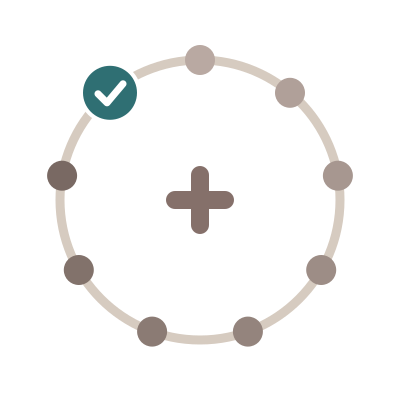

<p align="center">
  
</p>

# CareLoop application

CareLoop is an offline, synthetic-only prototype for making a screening
follow-up case visible, owned, escalated, handed off, evidenced, and closed.
It contains a SQLite-backed projection over one canonical E1-E9 transport
ledger, a paired Arm A/B-full simulator, and deterministic communication
helpers. It demonstrates workflow behaviour on synthetic data; it does not
demonstrate clinical effectiveness, safety, compliance, or production readiness.

The canonical transport ledger provides a transport-only E1-E9 event contract, pseudonymous `loop_id`,
explicit `UNKNOWN` visibility gaps, urgent/routine SLA tables, a daily
absence-of-event report, typed closure codes, positive handoffs, question-based
e-consults, result passports, patient-pull contact, barrier-aware patient
segments, switchable ablation arms, leakage maps, queue comparisons, and a
complete assumption registry. The active/default language segment is English;
Arabic content is structured communication data flagged for native-speaker review.

**Current maturity:** prototype / hackathon demonstration. The repository has
no production integration, no real patient data, no external clinical evidence
package, and no claim of clinical effectiveness. Every simulator parameter is
explicitly labelled `ASSUMPTION` in
`careloop/simulator/params/default.yml`.

## Reproducible setup

Python is pinned to **3.11.9** in `.python-version`. The runtime dependency
lock is intentionally empty: the core API, simulator, and tests use the Python
standard library. FastAPI and Uvicorn are optional accelerators; the
standard-library WSGI adapter remains available without them.

The verification below was run with the repository's Windows Python
environment. A fresh virtual-environment release gate is still required before
external submission.

The commands below do not download data or call external services.

## Run the API

```text
python -m api --host 127.0.0.1 --port 8000
```

Startup seeds deterministic synthetic demo data. Set `CARELOOP_DB` to a
SQLite path to persist it between runs. Pass `X-Actor-ID` (for example,
`navigator-1`, `clinician-1`, `manager-1`, or `patient-01`) to exercise role
filtering and authorization.

Implemented routes are documented in [docs/ARCHITECTURE.md](docs/ARCHITECTURE.md).
The core routes are `GET /health`, `POST /demo/seed`, `POST /demo/scenario`,
case list/create/detail, case actions, audit, analytics, and a FHIR R4-like
export. Aggregate analytics suppress groups with fewer than 10 cases.

## Run the simulator

The normal CLI invocation is a quick deterministic run (1,000 people × 10
runs). `--full` opts into the manifest defaults (10,000 people × 500 runs,
90 virtual days).

```text
python -m careloop.simulator --cohort-size 100 --runs 2 --seed 20261019 --json out/smoke.json --csv out/smoke.csv
python scripts/reproduce.py --output out
python -m careloop.simulator --bounded --cohort-size 200 --runs 10 --max-cohort-size 200 --max-runs 10 --json out/stress-200x10.json --csv out/stress-200x10.csv
```

Create `out/` first. The simulator is paired: both arms use the same seeded
cohorts and deterministic hash-based random draws. It reports closure,
ownership, teach-back, cross-provider, loss-to-follow-up, no-show,
unnecessary-escalation, escalation, backlog, timing, pathway, sensitivity,
and stress outputs. These are model outputs, not observed outcomes.

## Test

```text
python -B -m unittest discover -s tests -p "test_*.py"
```

The test suite is offline and covers loop invariants, role checks, stalls and
deduplicated escalation, deterministic paired simulation, output writing,
parameter provenance, communication review flags, SQLite reopen behavior,
FHIR-like export, and small-cell suppression.

transport-ledger checks also cover the seven-field E1-E9 event schema, unknown partner
reporting, daily absence reports, SLA loading, typed closure gates, positive
handoffs, e-consults, patient passports, module ablations, stress scenarios,
the complete registry, and transport-ledger output fields.

## Run the web prototype

The React/Vite front end is intentionally usable without the API: it starts
with seeded local demo data and exposes the command center, case detail,
navigator queue, consult workspace, English patient view,
simulation lab, and governance view. From `APP/`:

From PowerShell, run the already-executed web checks from the repository root:

```text
Set-Location web
npm ci --ignore-scripts --no-audit --no-fund
npm test
npm run build
```

Open the local Vite URL shown in the terminal. The UI is a prototype and does
not imply that a real patient or provider system is connected.

The full 10,000 × 500 study and Docker build are available but were not rerun
after the canonical-ledger migration; no result or build claim is made for
them in this revision. The Dockerfile defaults to loopback binding.

## Documentation

* [Documentation index](docs/README.md)
* [Architecture and routes](docs/ARCHITECTURE.md)
* [Data sources and provenance](docs/DATA_SOURCES.md)
* [Parameters](docs/PARAMETERS.md)
* [Assumptions and limitations](docs/ASSUMPTIONS_AND_LIMITATIONS.md)
* [Responsible AI](docs/RESPONSIBLE_AI.md)
* [Evaluation report](docs/EVALUATION_REPORT.md)
* [Pilot plan](docs/PILOT_PLAN.md)
* [Commercial framing](docs/COMMERCIAL.md)
* [Recorded decisions](docs/DECISIONS.md)
* [Changelog](docs/CHANGELOG.md)
* [Assumption registry](docs/ASSUMPTION_REGISTRY.md)
* [Security notes](SECURITY_NOTES.md)
* [Regulatory-readiness checklist](docs/REGULATORY_READINESS.md)
* [AI-use disclosure draft](docs/AI_USE_DISCLOSURE.md)
